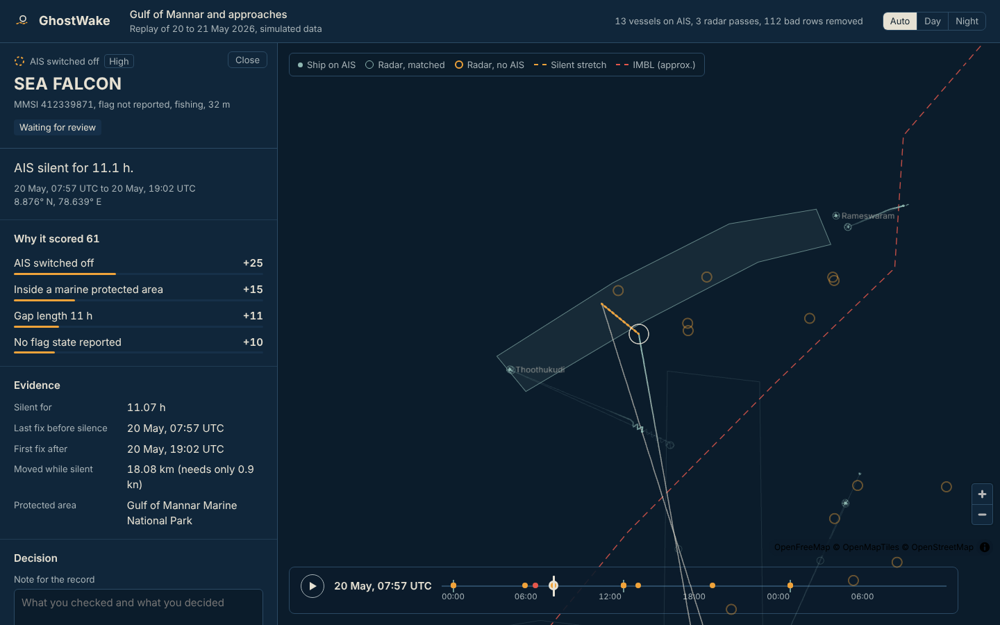
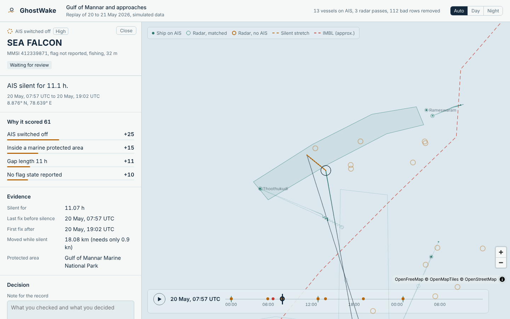
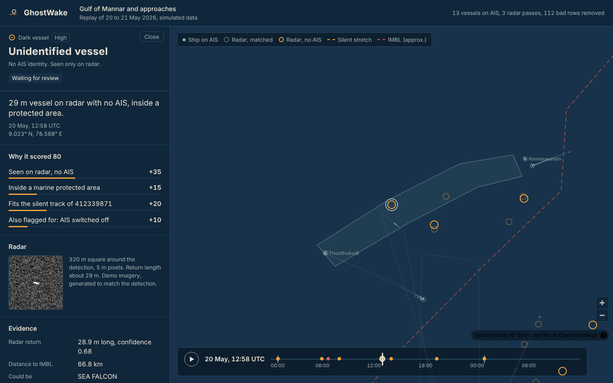
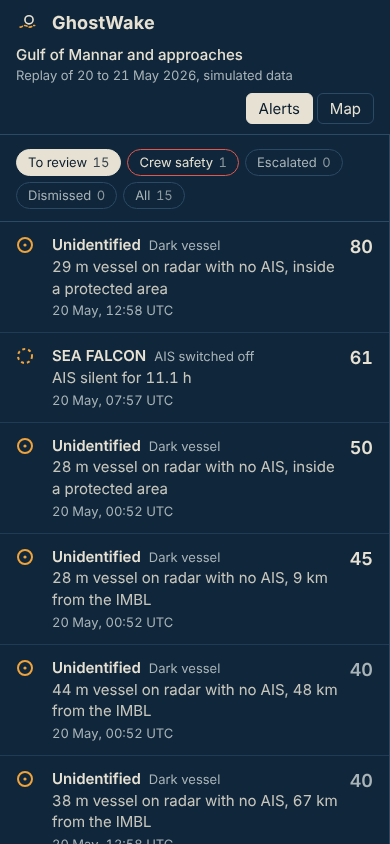

# GhostWake

[](https://github.com/Mahendr99ar/ghostwake/actions/workflows/ci.yml)
[](https://github.com/Mahendr99ar/ghostwake/actions/workflows/pipeline.yml)

**Live:** [ghostwake.vercel.app](https://ghostwake.vercel.app)
**API:** [health](https://ghostwake-api.onrender.com/api/health) | [interactive docs](https://ghostwake-api.onrender.com/docs)

> The API runs on Render's free plan and sleeps after 15 minutes without traffic. If the site says it can't reach the API, give it about a minute and refresh.

Ships can switch off their tracker. They can't hide their wake.

GhostWake watches the Gulf of Mannar and Palk Bay, between the southern tip of India and Sri Lanka. It matches satellite radar detections against AIS ship positions to find vessels that went quiet, flags behaviour that deserves a second look, and warns Indian fishing boats before they drift across the International Maritime Boundary Line. Every alert waits for a person to review it. The software never acts on its own.



## Why this area

Global tools such as [Global Fishing Watch](https://globalfishingwatch.org/map) already map dark fleets worldwide. What they don't do is apply the rules that matter to someone working this stretch of coast:

- Fishing crews from Rameswaram and nearby harbours are regularly detained after crossing the IMBL into Sri Lankan waters. A warning 30 to 60 minutes earlier is worth more to them than a map afterwards.
- The monsoon fishing ban starts on different dates on the east and west coasts, and a boat working through it is a different case from one that went quiet in open water.
- A fisheries officer needs a case file that shows where each number came from, not just a red dot.

GhostWake is built around those three things.

## What it flags

| Alert | How it is found | Who it is for |
| --- | --- | --- |
| Dark vessel | A radar return that no AIS ship can account for, after one-to-one matching with the Hungarian algorithm | Enforcement |
| Possible identity | The return sits on the straight line a silent ship would have followed between its last and next fix | Enforcement |
| AIS switched off | No position for 6 hours or more, away from harbour | Enforcement |
| Position spoofing | Two fixes that would need more than 40 knots to connect | Enforcement |
| Meeting at sea | Two ships within 0.5 km, both under 3 knots, for at least 2 hours, away from port | Enforcement |
| Fishing during the ban | Fishing speed away from harbour while that coast's ban is in force | Enforcement |
| Crossed or near the IMBL | An Indian fishing boat within 5 km of the line, or over it | Crew safety |

Each alert comes with:

- a score made of named reasons ("AIS switched off +25, inside marine park +15"), never a bare number
- its lineage: the pipeline run, the rule and thresholds used, the source records, and what the cleaner threw away on that run
- an append-only review log, so a dismissed alert keeps the note that explains why
- a printable case file

The copilot answers questions about alerts through four read-only tools. It refuses requests to act, and every number in its answer is checked against the data it looked up. It works without any language model (an offline writer builds the briefing), and can use any OpenAI-compatible endpoint if one is configured.

## Results

Measured by the test suite on the seed-7 scenario:

| Check | Result |
| --- | --- |
| AIS rows cleaned | 5,114 in, 5,002 out (100 duplicates, 12 broken positions) |
| Planted behaviours found | 5 of 5 |
| False alarms on boats tied up in harbour | 0 |
| Radar returns of AIS ships matched to the right ship | 34 of 34 |
| Dark-ship radar returns raised as alerts | 10 of 10 |
| Sea clutter raised as alerts | 0 of 6 |
| Silent ship linked to its radar return | 1 of 1, no wrong links |
| Warning time before the IMBL crossing | 53 minutes |
| Copilot eval cases (offline mode) | 13 of 13 |
| Backend tests | 29 passing |

These numbers come from simulated data that was built to contain these behaviours. They show the logic does what it should. They say nothing yet about performance at sea; that needs real AIS and real Sentinel-1 scenes.

## What is real and what is simulated

There is no free AIS feed for Indian waters, so the live demo replays a 36-hour synthetic scenario (20 to 21 May 2026). It is deliberately messy: duplicated rows, positions at 0,0, three timestamp formats, MMSIs written three different ways. Five behaviours are planted in it and recorded as ground truth, which is what the tests check against. Radar detections are simulated the same way, with position error, length error and sea clutter.

The radar side has two real detectors that need real data to show what they can do:

- `backend/ghostwake/detect/sar.py` is a CA-CFAR detector, the classic baseline.
- `backend/ghostwake/detect/train_yolo.py` trains a YOLO ship detector on the public [xView3-SAR](https://iuu.xview.us) dataset. It is meant for a free Kaggle or Colab GPU and reports point-matched F1 the way the xView3 challenge did.

The IMBL and the marine park outline are hand-drawn approximations. They are not legal boundaries and must never be used for navigation.

## Screenshots

| Day theme | Dark vessel case | Phone |
| --- | --- | --- |
|  |  |  |

The interface follows the device's light or dark setting, and the Auto / Day / Night switch overrides it for that browser. Day mode borrows from printed nautical charts; night mode from a chart room with the lights down.

## How it fits together

```
Public data             Processing                        Serving                People
-----------             ----------                        -------                ------
SAR imagery   ----->    batch: ship detection    -.
AIS tracks    ----->    stream: clean, rules     --+-->   fusion + risk  -->     FastAPI  -->  analyst console
Zones, IMBL   ----->    (synthetic in the demo)  -'       Postgres               copilot       fishing-boat warnings
                                                          event log              MCP server
```

| Part | Stack | Hosted on |
| --- | --- | --- |
| Pipeline and API | Python 3.12, FastAPI, SQLAlchemy 2, pandas, SciPy, H3 | [Render](https://render.com) (free) |
| Database | PostgreSQL; SQLite for local runs and tests | [Neon](https://neon.tech) (free) |
| Web app | React 18, TypeScript, Vite, MapLibre GL, deck.gl, TanStack Query | [Vercel](https://vercel.com) (free) |
| Basemap | OpenMapTiles vector tiles | [OpenFreeMap](https://openfreemap.org) |
| CI and daily refresh | pytest, ruff, vitest, offline copilot evals | GitHub Actions |

A few decisions worth knowing about:

- **The pipeline is idempotent.** Alert ids are hashes of what they describe, so a rerun updates evidence and scores but never overwrites an analyst's decision. The second run in a row reports `alerts_created: 0`.
- **Heavy work stays offline.** Radar detection is a batch job; the API only serves results, which is what lets it run on a free instance.
- **Live updates** reach the browser as server-sent events from an `events` table, so there is no message broker to host.

The reasoning behind these and the alert thresholds is written up in [docs/adr](docs/adr).

## Run it locally

You need Python 3.11 or newer and Node 20 or newer.

```bash
# API
cd backend
python -m venv .venv
source .venv/bin/activate        # Windows PowerShell: .\.venv\Scripts\Activate.ps1
pip install -e ".[dev]"
python -m ghostwake.pipeline     # builds ghostwake.db from the scenario
uvicorn ghostwake.api.main:app --reload
```

```bash
# Web app, in a second terminal
cd web
npm install
npm run dev                      # http://localhost:5173
```

The local analyst token is `change-me`. Set `GW_ANALYST_TOKEN` before showing the app to anyone.

To run everything with Postgres instead: `docker compose up --build`.

Tests:

```bash
cd backend && pytest -q && PYTHONPATH=. python evals/run_evals.py
cd web && npm test
```

Keyboard: `j` and `k` move through the queue, `Esc` closes a case, `Space` plays the replay.

## Deploying your own copy

Everything runs on free tiers. [DEPLOY.md](DEPLOY.md) goes through it step by step: Neon for the database, Render for the API, Vercel for the web app, and a GitHub Actions secret for the daily refresh.

## Project layout

```
backend/
  ghostwake/
    ingest/        synthetic scenario, AIS cleaning
    anomalies/     one function per behaviour rule
    fusion/        radar-to-AIS matching, dark-vessel identity
    detect/        CA-CFAR detector, YOLO training script, radar chips
    copilot/       read-only tools, LLM loop, offline writer, guardrails
    api/           HTTP API, live stream, case file
    risk.py        explainable scoring
    pipeline.py    one full run
    mcp_server.py  the same read-only tools over MCP
  tests/  evals/
web/src/
  components/      MapView, Queue, CasePanel, Timeline, SarChip, Glyph
  lib/             API client, track interpolation, theme, shared wording
docs/
  adr/             decision records
  screenshots/
```

## Known limits

- The data is simulated, and the thresholds are tuned to it. Real traffic will need retuning.
- The identity guess for a dark vessel uses a straight line between fixes. Currents and a Kalman filter would do better.
- Sentinel-1 misses most boats under 15 to 20 m, which is much of the Indian small-boat fleet. The IMBL warning depends on AIS, and many of those boats don't carry it.
- Reviewing uses one shared analyst token. A real deployment needs individual accounts.
- Scores are hand-weighted. Once enough alerts have been reviewed, those decisions should become training labels for a learned model.

## Responsible use

Public and synthetic data only. No imagery or analysis of military sites. The system tracks vessels and patterns, never individuals. The copilot is read-only, and every escalation is a person's decision with a written reason. [Global Fishing Watch](https://globalfishingwatch.org/our-apis/) data, if you add it, is free for non-commercial use only and must be credited.

## Further reading in this repo

- [DEPLOY.md](DEPLOY.md): putting your own copy online for free
- [STUDY_GUIDE.md](STUDY_GUIDE.md): a three-week walk through the code, in the order the data flows
- [docs/adr](docs/adr): why things are built the way they are
